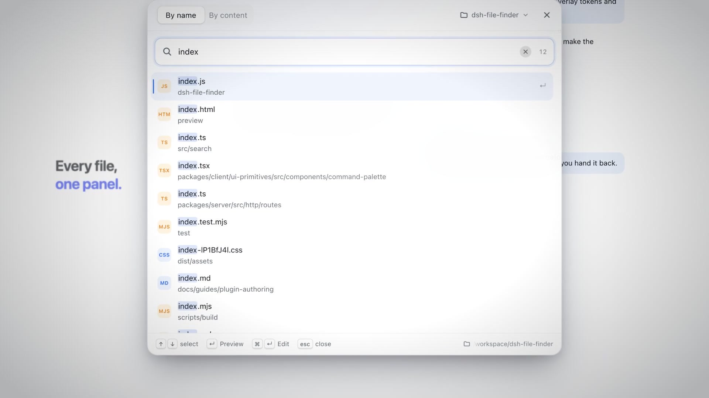
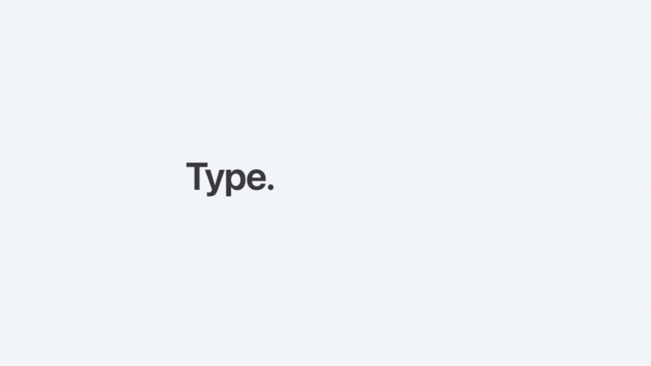
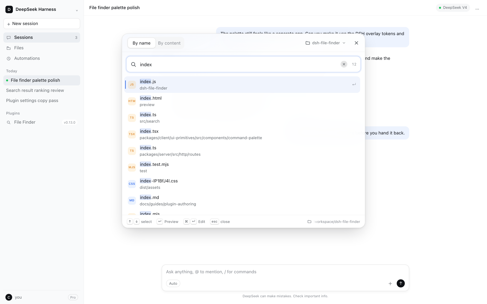
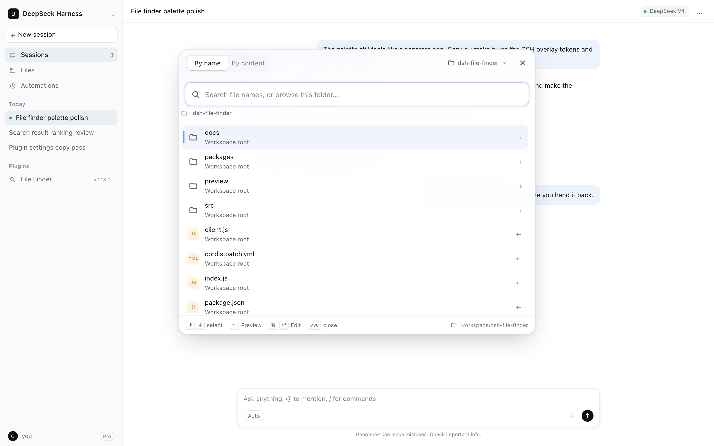
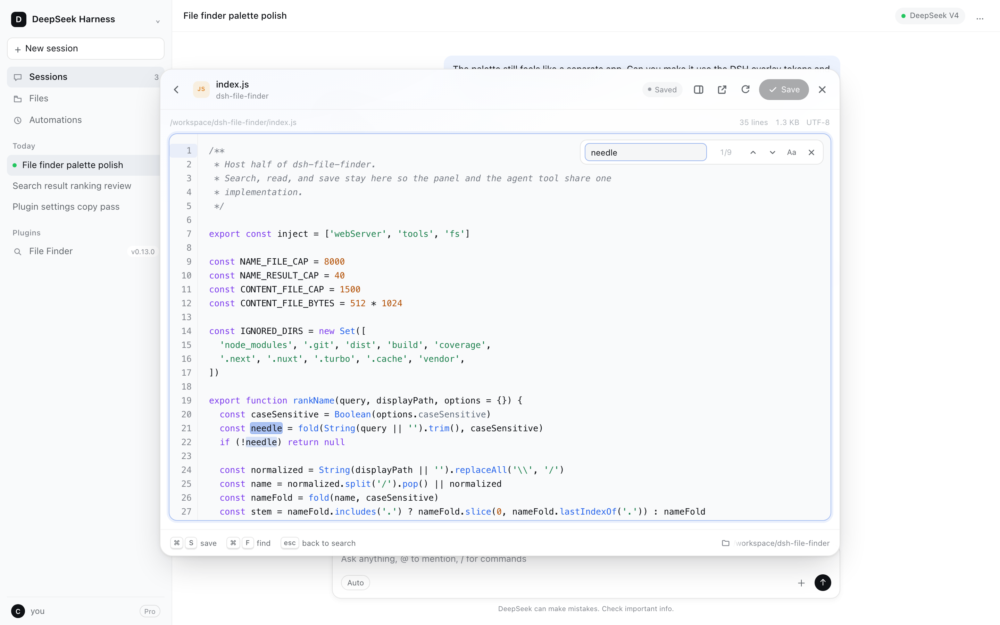
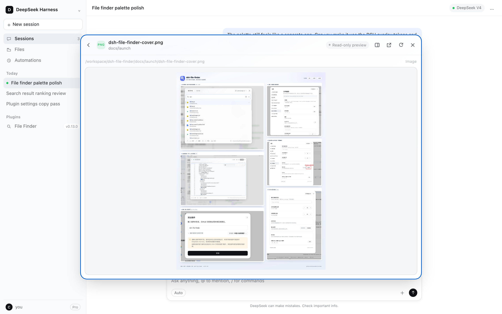
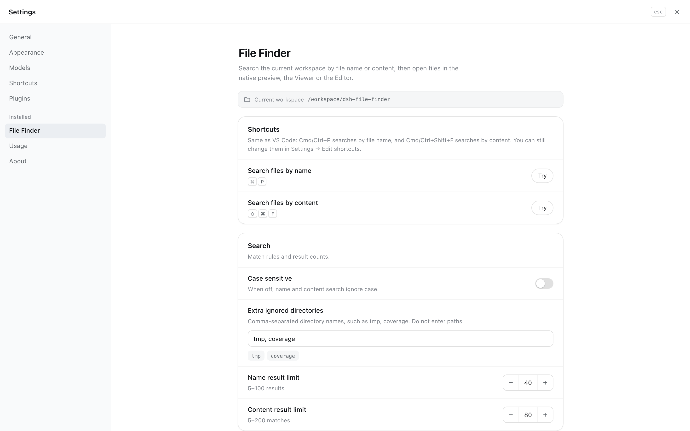
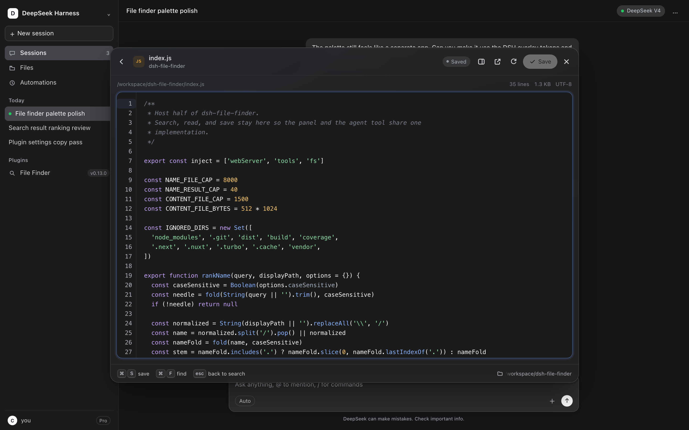
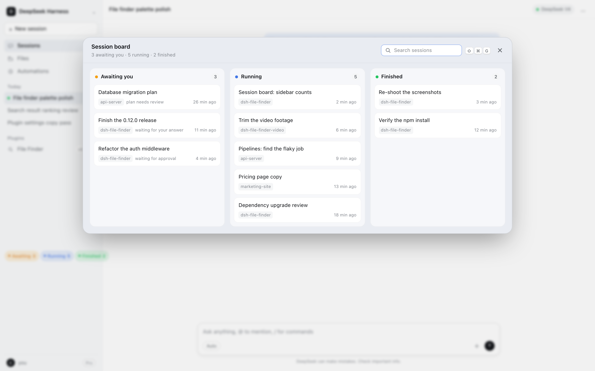
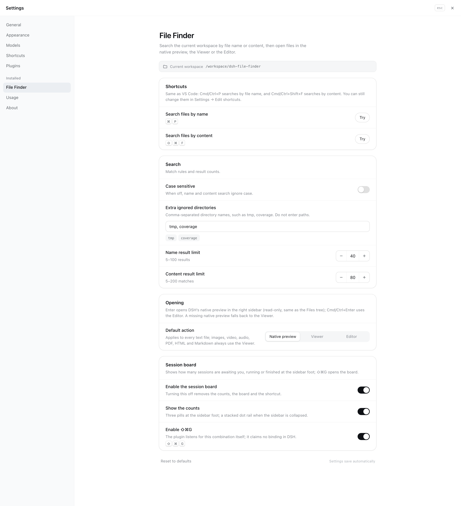

# dsh-file-finder

A DeepSeek Harness plugin for finding workspace files without leaving DSH: search by file name or by file content, browse the workspace when there is nothing to type, then open the result in DSH's native preview, the plugin's own viewer, or the built-in editor.

[中文文档](README.zh.md)



▶ **36-second tour (English, captions):** [dsh-file-finder-promo.mp4](docs/media/video/dsh-file-finder-promo.mp4) · [中文版](docs/media/video/dsh-file-finder-promo-zh.mp4)



## What it does

- **Browse when there is nothing to search**: with an empty query the palette lists the current workspace directory — folders first, then files — and you can walk into a folder (Enter or →), go back up (Backspace) or jump with the breadcrumb. Typing switches to the normal search, and clearing the query returns to the folder you were browsing. **Escape** walks back one screen at a time: from a viewer or the editor to the folder you opened it from, then up through the folders, and only then closes the panel.
- **Search by file name**, including a path fragment such as `src/view`.
- **Search by content**, with one result row per matching line.
- **Choose where files open**: one global **Open mode** picks which File surface Enter uses for text — **Native preview** (DSH's right-sidebar document preview, the default), the plugin's own **Viewer** (read-only, with syntax colours and in-file find) or the **Editor** (saves through DSH's workspace filesystem and refuses to overwrite a file that changed after it was loaded). Cmd/Ctrl+Enter always opens the other side of view/edit.
- **Media always uses the Viewer**: images, video, audio, PDFs, HTML and Markdown open in the plugin's Viewer whatever the Open mode is; kinds the Viewer cannot render (Office documents, archives, binaries) go to DSH's native preview instead, with a notice when it is unavailable.
- **Session board**: three pills at the sidebar foot count the sessions **awaiting you / running / finished** — the same facts DSH's own dots use (a pending approval or question, an Agent at work, a background finish you have not opened yet). Click a pill to open the board pre-filtered to that column, or press **⇧⌘G** (**Ctrl+Shift+G** on Windows/Linux) anywhere. Picking a row jumps into that session; search, Escape, and a single stacked column on narrow screens come with it. Three switches in Settings control the whole feature, the counts and the shortcut.
- **Desktop opener**: the Viewer and Editor carry an "Open in default app" button that hands the file to the operating system through DSH — a web page lands in the system's default browser (named as such on macOS, where DSH forces it), everything else in the app registered for that type. The host decides whether it reaches a desktop at all and which types it refuses, so executable files (scripts, app bundles, installers) never get the control, a host without a desktop does not show it, a failed open stays on the button as a retry, and a draft with unsaved changes keeps it inert until you save.
- **Native shortcuts**: Cmd/Ctrl+P and Cmd/Ctrl+Shift+F, like VS Code, without claiming a default binding in DSH's shortcut registry.
- **Optional DS Bot bridge**: when the DS Bot plugin is installed, Cmd/Ctrl+Shift+B flips between Bot mode and classic Agent mode; without it neither the shortcut nor its settings card exists.
- **Preview, not just text**: images, video, audio, PDFs, HTML pages and Markdown open in the built-in viewer; HTML runs in a sandbox, Markdown is rendered with DSH's own renderer, and relative images inside a Markdown file resolve to the workspace.
- **A redesigned settings page** with cards, keycaps, steppers, and switches, plus an "Opening" preference that chooses whether Enter previews or edits.
- **Polished interaction**: a frosted command palette, spring-eased mode switch, selected-row rail, loading skeletons, and reduced-motion support.

## File system: it already uses DSH's

There is no second filesystem hidden in this plugin:

| Operation | Owner |
| --- | --- |
| Walking, reading, writing workspace files | DSH's `ctx.fs` seam (`index.js`) |
| Search and ranking | This plugin (DSH exposes no reusable search service) |
| Opening in the Native preview | DSH's right-sidebar document preview, via `ctx.sidebarRight.openResource()` and a `dsh-resource://file/session/<sessionId>/<path>` address |
| Opening in the Viewer | This plugin's read-only surface, rendered inside its own overlay |
| Editing and conflict checks | This plugin's editor, over the same `ctx.fs` seam |

The plugin is deliberately **additive**: it registers nothing into DSH's own file surfaces (no document renderer, no right-sidebar tab type, no shadowing of the Files tree), so DSH updates keep applying and uninstalling the plugin leaves DSH exactly as it was. This is recorded in [ADR 0001](docs/adr/0001-file-surfaces-stay-additive.md).

When the native preview is unavailable (no live Session, or a shell without the right sidebar), the plugin falls back to the Viewer and says so.

## Shortcuts

| Action | Default keys |
| --- | --- |
| Search by file name | Cmd/Ctrl+P |
| Search by content | Cmd/Ctrl+Shift+F |
| Toggle DS Bot / classic Agent mode (only with the DS Bot plugin installed) | Cmd/Ctrl+Shift+B |

The commands are registered with DSH's shortcut service so you can assign your own keys in **Settings → Edit shortcuts**, but they declare **no default binding**. DSH's registry throws when one command's default overlaps another's, and it throws from inside the *other* plugin's `apply()`, so claiming Cmd+Shift+F here took the whole Web UI boot down (`Conflicting shortcut defaults: session.fork and files.searchContent`). The VS Code keys above are served by this plugin's own keydown handler instead.

Note that Cmd+Shift+F is DSH's own "fork session" binding; this plugin uses it for content search, so rebind `session.fork` in **Settings → Edit shortcuts** if you relied on it.

In the browser Web shell (not the desktop app), Cmd+Shift+B is DSH's right-sidebar toggle. With DS Bot installed this plugin takes that key for the mode switch, so assign a different key to `files.toggleBotMode` in **Settings → Edit shortcuts** if you need the sidebar binding there. On the desktop app the combination is free.

## DS Bot mode switch (optional)

When the DS Bot plugin (`ds-bot`) is part of the running boot, this plugin also offers **Toggle Bot / classic Agent mode** on Cmd/Ctrl+Shift+B, plus a matching card in **Settings → File Finder**.

DS Bot keeps its surface switch private — it exposes no client service — so the bridge does the two things another plugin safely can: it detects `ds-bot` in the boot graph, and it drives the controls DS Bot renders itself (the account menu's surface-switch entry to leave Bot mode, and the DS Bot return pill to come back). Nothing is patched or forked, and DS Bot's own `ds-bot:surface` preference stays authoritative.

Without DS Bot nothing is registered or shown: the command never reaches **Settings → Edit shortcuts**, the settings card stays hidden, and Cmd/Ctrl+Shift+B is left to whatever else owns it.

## Settings

**Settings → File Finder** covers:

- Shortcut reference with one-click try buttons, including **Open file browser** (no default binding)
- Case sensitivity
- Extra ignored directory names (with live chips)
- Name and content result limits (steppers)
- The global Open mode: **Native preview**, **Viewer** or **Editor** (media always opens in the Viewer)
- Reset to defaults; changes save automatically

## Editing

Choose a result and press Cmd/Ctrl+Enter (or set the built-in editor as the default action). Save writes the full text back through the workspace filesystem and refuses to overwrite a file that changed after it was loaded. Reload, then save again, to take the newer version. The editor is for UTF-8 text under about 1 MB. Binary files and common build or dependency directories are skipped.

Escape in the viewer returns to the folder you opened the file from; the same key works while a previewed HTML page has focus, because the host injects a small Escape forwarder into the served document.

Files that are not text open in the built-in viewer instead: images, video and audio render inline (byte ranges, so video seeking works), PDFs open in the platform frame, HTML pages run in a sandboxed iframe whose scripts cannot reach DSH, and Markdown is rendered with DSH's Markdown renderer, with an **Edit source** button that hands the file to the text editor.

Hold **Cmd/Ctrl** in the editor and every identifier that resolves gains a dotted underline and a pointer: hovering shows its kind, its declaration and the line, and Cmd/Ctrl-click jumps to the definition. **Cmd/Ctrl+[** (or the back button in the header) returns to where you came from. Resolution is same-file for now — the declaration scan covers JS/TS, Python, Go, Rust, Java/C-like, HTML anchors and a generic fallback; project-wide TypeScript resolution is the next phase.

Text is coloured lexically: keywords, types, strings, numbers, comments, calls, properties and HTML/CSS/JSON/Markdown markup each get their own colour in both DSH themes. Markup files also colour what hides inside them — Vue/Svelte/HTML `<script>` blocks run the script scanner, `<style>` blocks the CSS one, and Vue `{{ }}` expressions and directive values (`:prop`, `@click`, `v-if`) are coloured as code — and a Markdown fenced block is coloured as the language it names. The textarea keeps the caret, selection and IME; only the visible lines are painted, so a large file scrolls without lag. Files over 200 KB fall back to plain text and say so in the header, and an open in-file search keeps the colours behind its highlight.

The editor shows a line-number gutter and highlights the caret's line. **Cmd/Ctrl+F** opens in-file search: every match is highlighted, the current one more strongly, with a match count, previous/next buttons, and a **Aa** case-sensitivity toggle. Enter and Shift+Enter step through matches, Escape closes the search and returns focus to the text.

## Screenshots

| | |
| --- | --- |
|  |  |
| **Search by name or path** | **Browse when the query is empty** |
|  |  |
| **Syntax colours, line numbers, in-file find** | **Built-in viewer for images, HTML, Markdown, video** |
|  |  |
| **One global Open mode over three surfaces** | **The same editor in the dark theme** |
|  |  |
| **Session board: awaiting you, running, finished** | **Three switches: feature, counts, ⇧⌘G** |

## Install

The plugin is published to npm as **`dsh-file-finder`**, so **Settings → Plugins → Add plugin** resolves the package name directly:

```sh
dsh plugin add dsh-file-finder
```

Or install from this checkout:

```sh
dsh plugin add /Library/aiProject/dsh-file-finder
```

Restart or refresh the DSH page if the new client module does not appear immediately.

The same operations are available to the agent as the `file_finder` tool.

## Development

```sh
node --check index.js
node --check client.js
npm test
```

`npm test` covers the search helpers, the Desktop opener's host action and refusal list, the shortcut-default regression guard, and the UI contract (native preview address, palette hooks, reduced-motion rules, the DS Bot bridge, and the editor's line gutter, in-file find and syntax colours).

Browser checks are split by feature:

```sh
npm run check:find
npm run check:viewer
npm run check:intel
npm run check:tokens
npm run check:browse
npm run check:board
```

The DS Bot bridge also has a browser check that runs the real key handler against DS Bot's real selectors, with and without `ds-bot` in the boot graph:

```sh
node preview/bot-check.mjs
```

The native-integration research — address grammar, session derivation, service access, HMR behavior, and the keep-vs-delegate matrix — is documented in [docs/native-integration.md](docs/native-integration.md).

`preview/` is a dev-only harness that renders the palette and settings page outside DSH with the real DSH theme tokens, and captures light/dark screenshots with Playwright:

```sh
node preview/screenshot.mjs
```

It is not part of the published package.

## License

MIT
