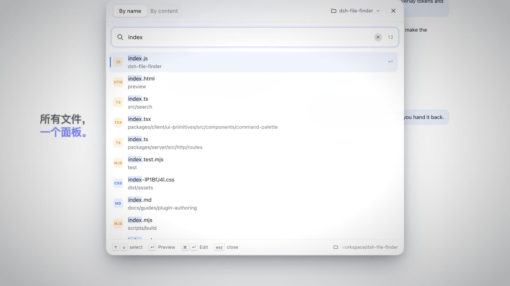
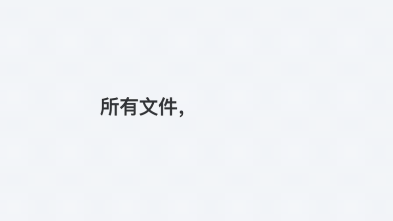
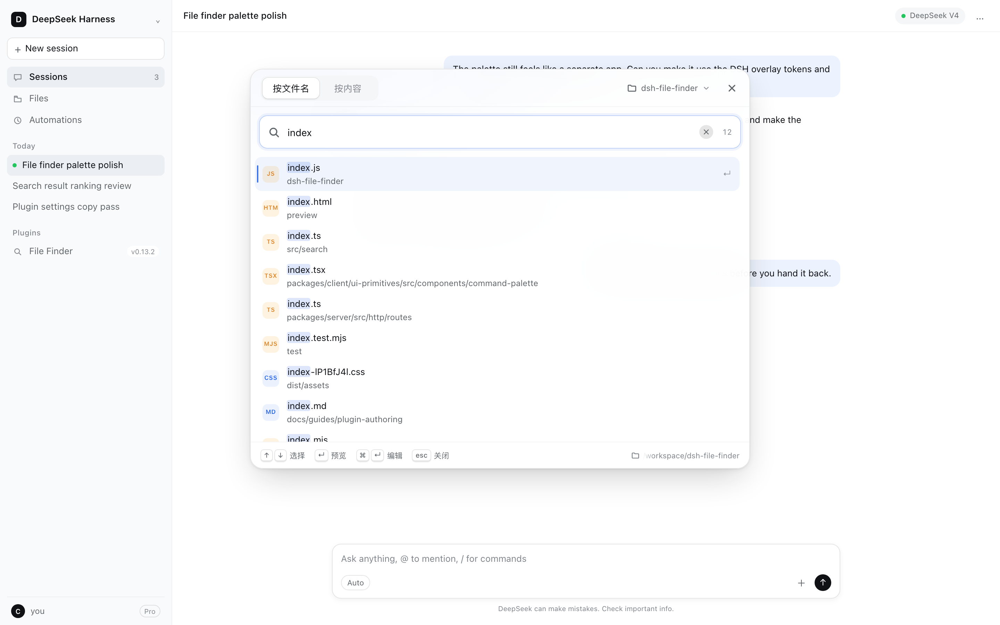
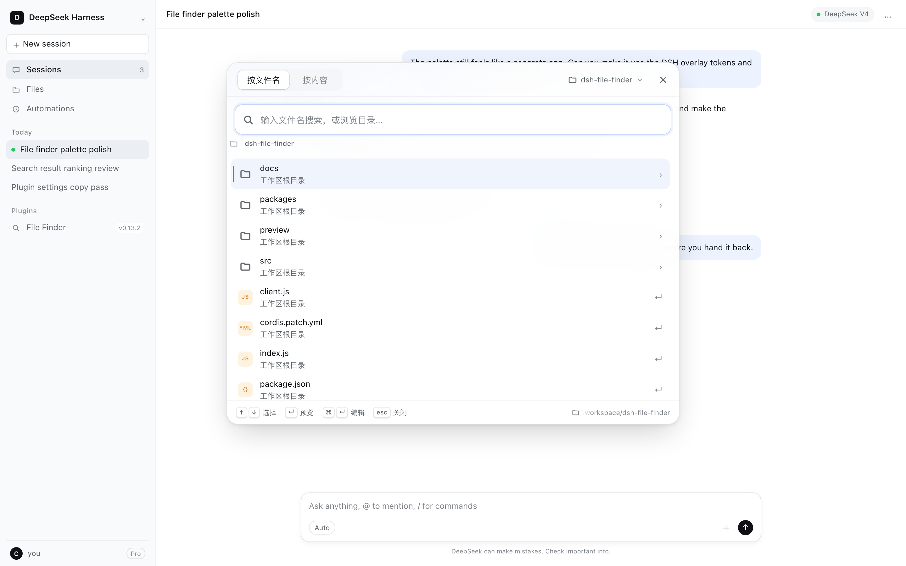
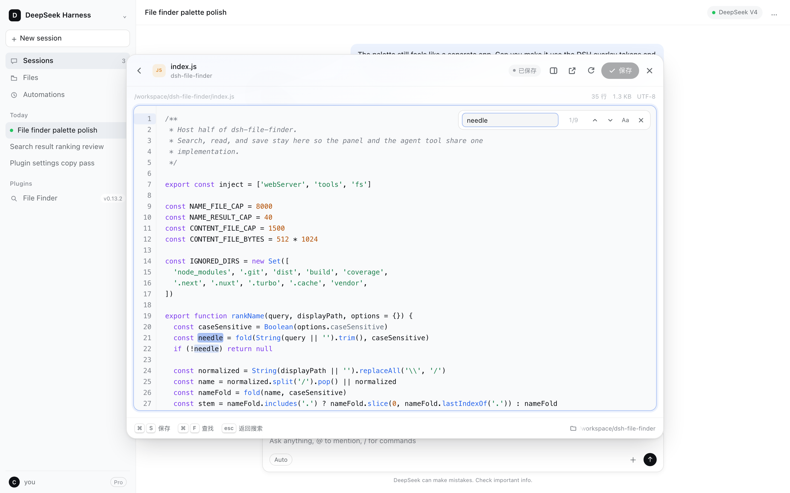
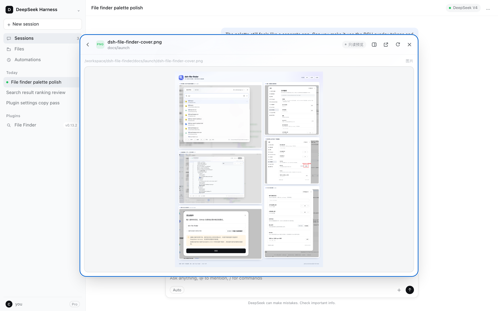
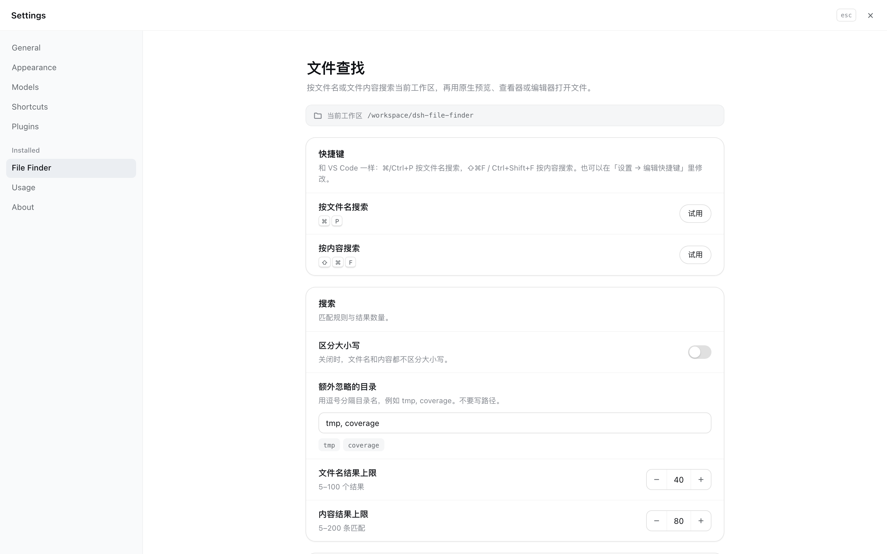
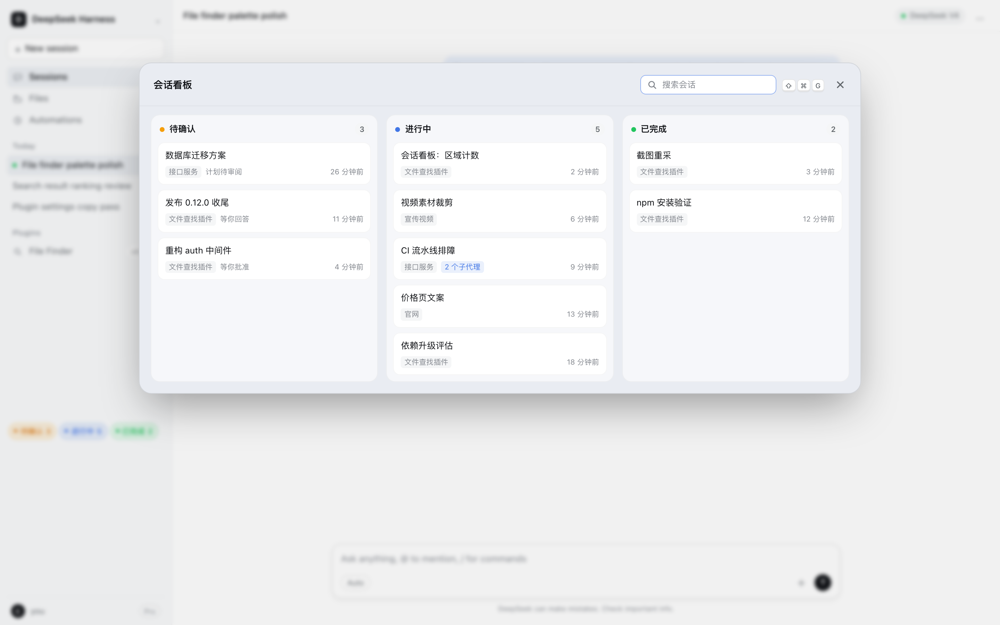
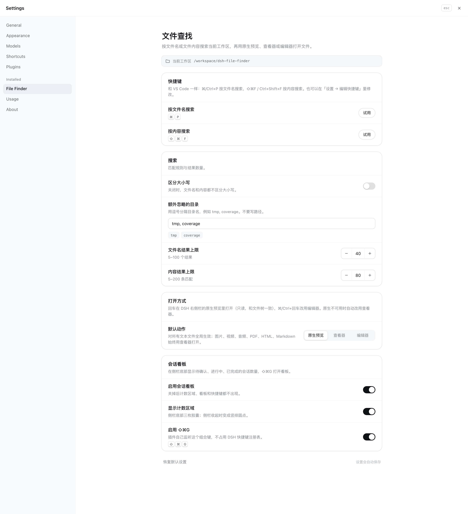

# dsh-file-finder

DeepSeek Harness 插件：在 DSH 里按文件名或文件内容查找工作区文件，用 DSH 自带右侧栏里的原生预览打开，需要修改时再切到内置编辑器。

[English](README.md)



▶ **36 秒介绍片（中文，带字幕）：** [dsh-file-finder-promo-zh.mp4](docs/media/video/dsh-file-finder-promo-zh.mp4) · [English version](docs/media/video/dsh-file-finder-promo.mp4)



## 能做什么

- **没有搜索词时直接浏览**：面板为空时列出当前工作区目录——文件夹在前、文件在后；回车或 → 进入下级，⌫ 返回上级，也可以点面包屑跳转。开始输入就切换成正常搜索，清空后回到刚才浏览的目录。**Esc** 逐层后退：先从事先的预览/编辑器回到打开它的目录，再逐级向上，最后才关闭面板。
- **按文件名搜索**，也可以直接搜路径片段，例如 `src/view`。
- **按文件内容搜索**，每一条命中单独一行，显示行号和上下文。
- **自己决定在哪里打开**：一个全局的 **打开方式** 决定文本文件回车后落在哪个 File surface——**原生预览**（DSH 右侧栏文档预览，默认）、插件自己的 **查看器**（只读，带语法着色和文件内查找）或 **编辑器**（保存通过 DSH 的工作区文件系统写回，文件被别的程序改过时拒绝覆盖）。⌘/Ctrl+回车 永远打开「看/编辑」的另一侧。
- **媒体始终走查看器**：图片、视频、音频、PDF、HTML 和 Markdown 无论打开方式是什么都进插件查看器；查看器渲染不了的类型（Office、压缩包、二进制）改交给 DSH 原生预览，原生不可用时给出提示。
- **会话看板**：侧栏底部三枚胶囊显示**待确认 / 进行中 / 已完成**的会话数量（语义就是 DSH 自己的会话状态：等你审批或回答、Agent 正在跑、后台跑完但你还没点开）。子代理会归并到它所属的会话里：子代理还在跑，父会话就算进行中（卡片上标出数量），子代理等你确认，父会话就算待确认，而每个会话仍然只算一次，点任一枚打开完整看板；**⇧⌘G**（Windows/Linux 为 **Ctrl+Shift+G**）随时开关看板。看板里点一条会直接进入那个会话，支持搜索、Esc 关闭，窄屏时三列自动堆成竖排。设置里三个开关分别控制总开关、计数区域和快捷键。
- **Desktop opener（交给系统应用）**：查看器和编辑器右上角有一个按钮，通过 DSH 把文件交给操作系统——网页进系统默认浏览器（在 DSH 强制浏览器的 macOS 上直接叫「用浏览器打开」），其他文件进该类型登记的应用。是否连得着桌面、哪些类型拒绝，都由宿主决定，所以可执行文件（脚本、App 包、安装包）永远不会有这个按钮，没有桌面的宿主也不显示；打开失败会留在按钮上可以直接重试，有未保存修改时按钮保持不可点，保存后才能用。
- **VS Code 习惯的快捷键**：⌘/Ctrl+P 与 ⌘/Ctrl+Shift+F，但不占用 DSH 快捷键注册表的默认键位。
- **可选的 DS Bot 桥接**：装了 DS Bot 插件时，⌘/Ctrl+Shift+B 在 Bot 模式与经典 Agent 模式之间来回切换；没装时快捷键和设置卡片都不存在。
- **不只是文本**：图片、视频、音频、PDF、HTML 和 Markdown 用内置预览打开——视频走字节范围请求，可以拖进度条；HTML 在沙箱里跑，脚本碰不到 DSH 页面；Markdown 用 DSH 自己的渲染器，文内相对路径的图片会解析到工作区。
- **重新设计的设置页**：卡片分组、键帽、步进器和开关，并新增「打开方式」选择，决定回车是预览还是编辑。
- **更细腻的交互**：磨砂质感的命令面板、弹性切换动画、选中行指示条、加载骨架，以及 reduced-motion 支持。

## 文件系统：本来就用的是 DSH 自带的

插件里没有另一套文件系统：

| 操作 | 归属 |
| --- | --- |
| 遍历、读取、写入工作区文件 | DSH 的 `ctx.fs` 文件系统接口（`index.js`） |
| 搜索与排序 | 本插件（DSH 没有对外暴露可复用的搜索服务） |
| 在原生预览中打开 | DSH 右侧栏文档预览：`ctx.sidebarRight.openResource()` + `dsh-resource://file/session/<sessionId>/<path>` 地址 |
| 在查看器中打开 | 本插件的只读界面，渲染在自己的弹框里 |
| 编辑与冲突检查 | 本插件的编辑器，同样走 `ctx.fs` |

插件是**纯加法**的：不往 DSH 自己的文件界面注册任何东西（不注册文档渲染器、不注册右侧栏 tab 类型、不 shadow Files 树），所以 DSH 更新照常生效，停用/卸载插件后 DSH 恢复原样。这条决定记录在 [ADR 0001](docs/adr/0001-file-surfaces-stay-additive.md)。

如果原生预览不可用（没有活动会话，或当前界面没有右侧栏），插件会改用查看器并给出提示。

## 默认快捷键

| 操作 | 桌面版 | 网页版 |
| --- | --- | --- |
| 按文件名 | ⌘/Ctrl+P | ⌘/Ctrl+P |
| 按内容 | ⇧⌘F / Ctrl+Shift+F | ⇧⌘F / Ctrl+Shift+F |
| 切换 Bot / 经典 Agent 模式（仅装了 DS Bot 时） | ⇧⌘B / Ctrl+Shift+B | ⇧⌘B / Ctrl+Shift+B |

三个命令都注册到 DSH 的快捷键服务里，可以在 **设置 → 编辑快捷键** 中另外指定键位，但**不声明默认值**。DSH 的快捷键注册表在检测到默认键位撞车时会在*对方*插件里抛错，会把整个界面启动搞崩（`Conflicting shortcut defaults: session.fork and files.searchContent`）。所以上面的 VS Code 键位由插件自己的按键监听实现。

> 注意：⇧⌘F 在 DSH 里原本是「fork 会话」，本插件按 VS Code 习惯把它用于内容搜索。需要原来的 fork 的话，在「设置 → 编辑快捷键」里给 fork 换一个键即可。

> 网页版（非桌面 App）里 ⇧⌘B 原本是 DSH 的右侧栏开关。装了 DS Bot 时本插件会占用这个组合做模式切换；如果网页版里还需要侧栏开关，在「设置 → 编辑快捷键」里给 `files.toggleBotMode` 换一个键即可。桌面版里这个组合是空闲的。

## DS Bot 模式切换（可选）

当前这次启动里带了 DS Bot 客户端模块（`ds-bot`）时，本插件会额外提供 **切换 Bot / 经典 Agent 模式**（⌘/Ctrl+Shift+B），并在 **设置 → 文件查找** 里多一张对应的卡片。

DS Bot 的模式切换是它自己的私有状态，没有对外暴露客户端服务，所以这个桥接只做两件别家插件能安全做的事：从启动清单里识别 `ds-bot`，以及点击 DS Bot 自己渲染的控件（账号菜单里第二组的那一项用于离开 Bot 模式，DS Bot 的返回按钮用于切回来）。不 patch、不 fork，模式的真实来源仍然是 DS Bot 自己的 `ds-bot:surface` 偏好。

没装 DS Bot 时什么都不会注册或显示：命令不会出现在 **设置 → 编辑快捷键** 里，设置卡片隐藏，⌘/Ctrl+Shift+B 留给原本占用它的功能。

## 设置

**设置 → 文件查找** 包含：

- 快捷键参考和一键试用，含**打开文件浏览器**（不占默认键位）
- 区分大小写
- 额外忽略的目录（输入时实时显示为标签）
- 文件名 / 内容结果数量上限（步进器）
- 全局打开方式：**原生预览**、**查看器** 或 **编辑器**（媒体始终走查看器）
- DS Bot 模式切换（只有装了 DS Bot 时才出现）
- 恢复默认设置；修改后自动保存

## 编辑

选中结果后按 ⌘/Ctrl+回车（或把「内置编辑」设为默认动作）打开编辑器。⌘/Ctrl+S 保存；保存使用打开时读到的版本，如果文件期间被别的程序改过，会拒绝覆盖，需要先重新加载。只编辑约 1 MB 以内的 UTF-8 文本。二进制文件，以及 `node_modules`、`.git`、构建目录等，不会进入搜索。

在预览里按 Esc 会回到打开这个文件的目录；HTML 预览即使焦点在页面里也能用——宿主会给送出的 HTML 注入一小段 Esc 转发脚本。

不是文本的文件会走内置预览：图片、视频、音频直接渲染（字节范围请求，视频能拖进度），PDF 用平台预览框，HTML 放在沙箱 iframe 里（脚本访问不到 DSH 页面），Markdown 用 DSH 的 Markdown 渲染器，并带一个「编辑源码」按钮切回文本编辑器。

在编辑器里按住 **⌘/Ctrl**，能解析的标识符会变成虚线加手型：悬停显示类型、声明和行号，⌘/Ctrl+点击跳到定义，**⌘/Ctrl+[**（或标题栏的返回按钮）回到上一处。当前是**同文件**解析——声明扫描覆盖 JS/TS、Python、Go、Rust、Java/C 系、HTML 锚点和通用兜底；跨文件的 TypeScript 解析是下一阶段。

文本按语法着色：关键字、类型、字符串、数字、注释、调用、属性，以及 HTML/CSS/JSON/Markdown 的标记各有颜色，亮暗两套主题分别配色。标记类文件里嵌着的语言也会着对应颜色——Vue/Svelte/HTML 的 `<script>` 走脚本规则、`<style>` 走 CSS 规则，Vue 的 `{{ }}` 插值和 `:prop`、`@click`、`v-if` 这类指令值按代码着色；Markdown 里标了语言的代码围栏按该语言着色。输入框仍负责光标、选区和输入法；只绘制可见行，大文件滚动不卡。超过 200 KB 的文件自动退回纯文本并在标题栏说明，文件内查找时颜色会保留在高亮下面。

编辑器左边有行号栏，并高亮光标所在行。**⌘/Ctrl+F** 打开文件内查找：所有命中都会高亮、当前命中更醒目，带命中计数、上一个/下一个按钮和 **Aa** 区分大小写开关；回车/⇧回车切换命中，Esc 关闭查找并把焦点交还正文。

## 截图

| | |
| --- | --- |
|  |  |
| **按文件名或路径搜索** | **没有搜索词时浏览目录** |
|  |  |
| **语法着色、行号、文件内查找** | **内置查看器：图片、HTML、Markdown、视频** |
|  |  |
| **一个全局「打开方式」覆盖三种界面** | **同一编辑器在深色主题下** |
|  |  |
| **会话看板：待确认 / 进行中 / 已完成** | **三个开关：总开关、计数区域、⇧⌘G** |

## 安装

插件已发布到 npm（包名 **`dsh-file-finder`**），在 **设置 → 插件 → 添加插件** 里直接输入包名即可：

```sh
dsh plugin add dsh-file-finder
```

也可以从本地目录安装：

```sh
dsh plugin add /Library/aiProject/dsh-file-finder
```

安装后如果页面没有马上出现入口，刷新 DSH 页面。Agent 也可以调用同名能力：工具 `file_finder`。

仓库：<https://github.com/chzisnull/dsh-file-finder>

## 开发

```sh
node --check index.js
node --check client.js
npm test
```

`npm test` 覆盖搜索函数、快捷键默认值的防回归测试，以及 UI 契约（原生预览地址、面板钩子、reduced-motion 规则、DS Bot 桥接，以及编辑器的行号栏、文件内查找与语法着色）。

浏览器检查按功能分开：

```sh
npm run check:find
npm run check:viewer
npm run check:intel
npm run check:tokens
npm run check:browse
npm run check:board
```

DS Bot 桥接还有一个浏览器检查，用 DS Bot 真实的类名跑一遍按键逻辑，分别验证启动清单里有 / 没有 `ds-bot` 两种情况：

```sh
node preview/bot-check.mjs
```

原生集成的调研结论——地址语法、会话推导、服务获取方式、HMR 行为以及「保留 / 委托」矩阵——记录在 [docs/native-integration.md](docs/native-integration.md)。

`preview/` 是只在开发时使用的预览工程：用真实的 DSH 主题变量在 DSH 之外渲染命令面板与设置页，并用 Playwright 生成明暗两套截图：

```sh
node preview/screenshot.mjs
```

它不会被打进发布包。

## License

MIT
